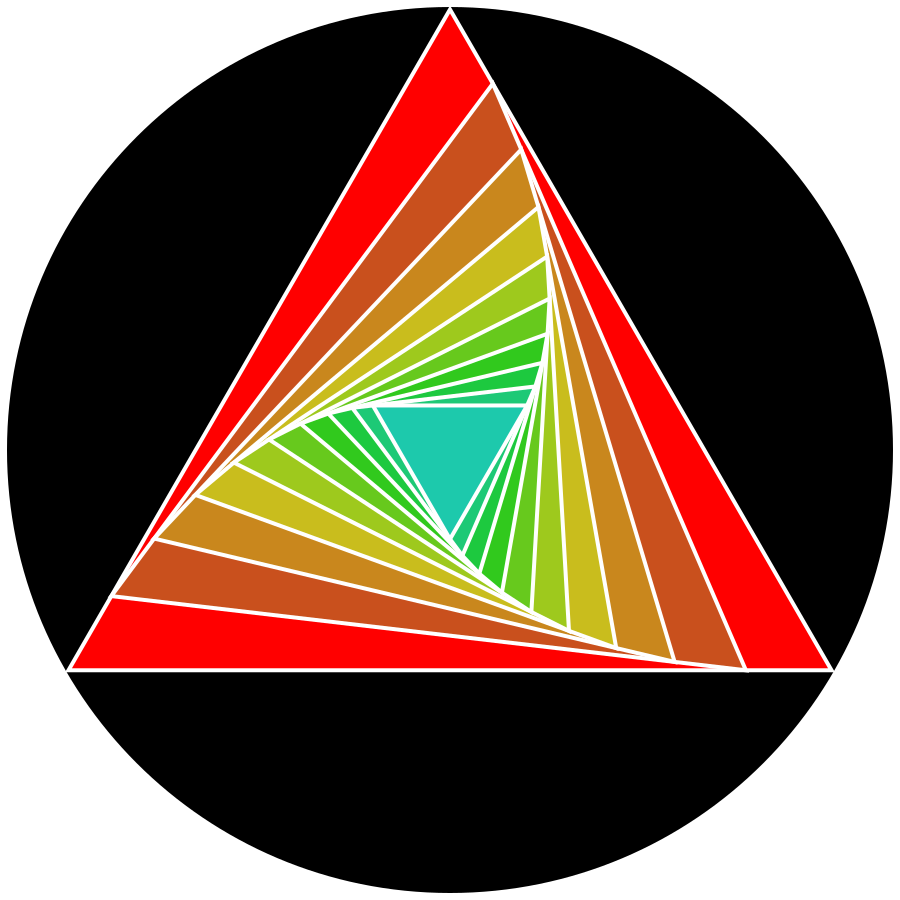
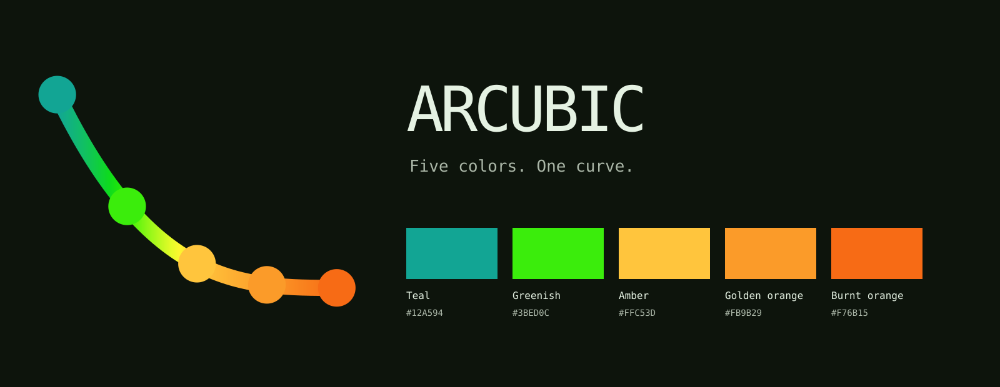
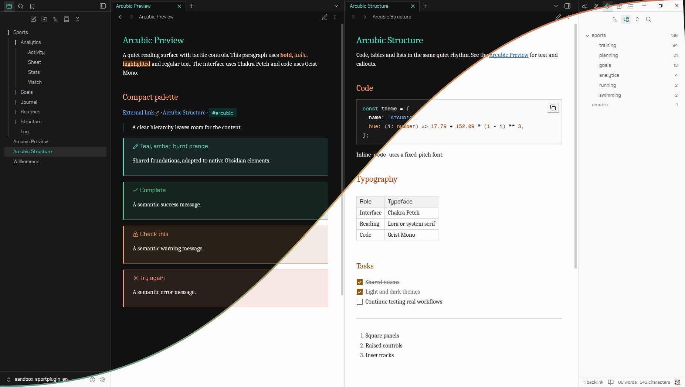

# Arcubic



Teal, amber and burnt orange on neutral grayscale surfaces. A design system with square panels, raised controls, inset fields and a sliding triangle switch, available for Obsidian, React, VS Code and terminals.

## Obsidian

A light and dark theme with neutral surfaces, teal accents and tactile controls.



Raised buttons, recessed inputs and triangle switches give controls a tactile feel, while square panels and connected tabs keep the workspace structured. Headings and tags use the accent palette; links stay blue. The theme supports reading view and Live Preview, with serif reading text and monospace code.

### Install

1. Open **Settings → Appearance → Themes → Manage** in Obsidian.
2. Search for **Arcubic**.
3. Select **Install and use**.

Requires Obsidian 1.8.0 or newer. Plugin interfaces may need additional styling.

For manual installation, download `arcubic-obsidian-<version>.zip` from the [latest release](https://github.com/trainvent/arcubic/releases/latest), extract its `Arcubic` folder into your vault's `.obsidian/themes/` folder, then select **Arcubic** in **Settings → Appearance → Themes**.

### Fonts and settings

Chakra Petch for the interface and Geist Mono for code are included in the theme and work offline. Reading text uses Lora when installed, with a system serif as the fallback.

Use Obsidian's **Settings → Appearance** to choose light or dark mode, override fonts and adjust text size. No companion plugin or separate font download is required.

## React and Next.js

Install the [npm package](https://www.npmjs.com/package/@trainvent/arcubic) and import its stylesheet once in your application layout:

```sh
npm install --save-exact @trainvent/arcubic
```

```tsx
import '@trainvent/arcubic/styles.css';
import { Theme, Button } from '@trainvent/arcubic';

<Theme appearance="dark">
  <Button variant="outline">Get started</Button>
</Theme>
```

The package includes React 19 components, TypeScript declarations, light and dark tokens, and the bundled fonts. Plain CSS tokens are available as `@trainvent/arcubic/tokens.css`. See the [package guide](packages/react/README.md) for Next.js setup and all exports. [leonmarq.com](https://leonmarq.com) uses it; its [source](https://github.com/leonmarq/website) shows a complete setup.

## VS Code

Install **Arcubic** from the VS Code Marketplace or Open VSX. It has Arcubic Light and Dark, and an optional stylesheet for raised buttons and the triangle loader. See the [VS Code guide](ports/vscode/README.md).

## Terminal

Download the terminal palette from the [latest release](https://github.com/trainvent/arcubic/releases/latest). See the [terminal guide](ports/terminal/README.md).

## Design

Surfaces and body text stay neutral gray. Teal is the primary accent and marks tags; amber and burnt orange add secondary emphasis. Green, red and blue are reserved for success, errors and links. Depth shows what you can press or type into, and triangles show direction, state and progress.

The [project guide](docs/dev/arcubic.md) has the full styling guidelines, the color system and how to build Arcubic for a new app.

## Feedback

Report problems through [GitHub issues](https://github.com/trainvent/arcubic/issues). Include the app and its version, light or dark mode, and a screenshot when useful. See the [release notes](https://github.com/trainvent/arcubic/releases) for what changed.

## License

Arcubic is an alpha release. Its code is [MIT licensed](LICENSE); bundled fonts retain their OFL licenses. The name, logo and triangle loader are Trainvent [trademarks](TRADEMARKS.md).
