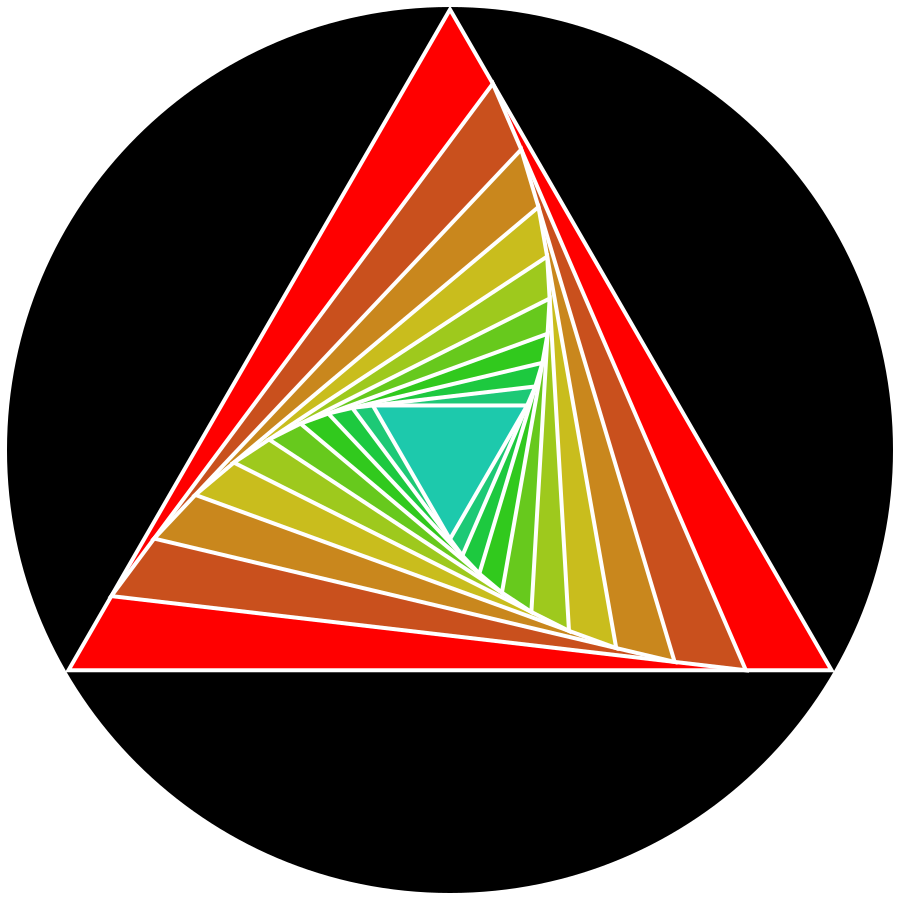
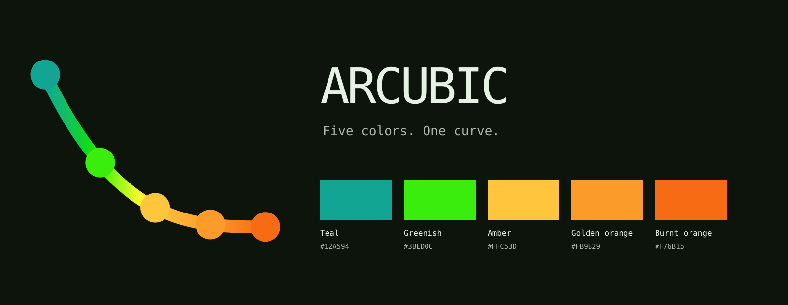

# Arcubic



Teal, greenish, amber, golden orange and burnt orange on subtle greenish surfaces. A reusable design system with square panels, raised controls, inset fields and a sliding triangle switch.

## Styling guidelines

Arcubic aims for a precise, technical interface with a tactile feel. Clear structure, restrained color and deliberate geometry should make the controls feel coherent across websites and applications.

- **Use depth where interaction benefits from it.** Raised buttons suggest pressing; inset fields and tracks suggest input. Keep content panels quiet and flat. A thin bevel is usually enough, especially on compact controls; preserve space for their text and icons.
- **Keep the structure geometric.** Favor square edges, aligned boundaries and consistent spacing. Active document tabs should connect to their page, while inactive tabs recede into the surrounding surface.
- **Make triangles functional.** Use them for direction, state and progress: the switch slides left/down when off and right/up when on, and the loader follows a triangular path. Keep angles, proportions and internal spacing consistent as these elements scale.
- **Keep hover, selection and focus distinct.** Hover is a small change in brightness or text color. Selection persists after the pointer leaves. Keyboard focus stays visible with a light, single outline. Avoid stacked focus rings, heavy hover boxes and separate highlights around button text.
- **Give color a clear role.** The greenish family provides subtly tinted surfaces and body text. Teal marks titles, selection and primary controls; greenish marks subheadings; amber marks sections; golden orange remains a secondary accent; burnt orange marks links. Semantic success Green and error Tomato remain separate.
- **Let typography do its job.** Use a technical interface face, a comfortable reading face and a true monospace for code. Keep labels legible at small sizes and leave enough room for descenders, including in placeholders, tags and truncated labels.
- **Make motion explain a change.** Keep transitions short and purposeful: a button depresses, a switch travels and rotates, a loader indicates progress. Respect reduced-motion preferences.
- **Adapt to the host without losing the system.** Preserve native behavior and keyboard interaction. Test normal, hovered, pressed, selected, focused and disabled states in context, in both light and dark modes. Check contrast against the actual surface behind the text.

The guiding principle is restraint: geometry gives Arcubic its character, while depth and color help people understand what they can do.

## Alpha release

Download the [0.1.4 alpha release](https://github.com/Trainvent/arcubic/releases/tag/0.1.4) for the installable Obsidian theme, shared CSS tokens and terminal palette. See [installation and known limitations](docs/alpha-release.md). The current build bundles Chakra Petch, Lora and Geist Mono under the OFL.

The root `manifest.json`, `theme.css` and `versions.json` are generated Obsidian distribution files. Native source stays in `ports/obsidian/`; shared web tokens and components stay independent. Rebuild with `npm run build:obsidian` after changing the adapter.

Arcubic's code is [MIT licensed](LICENSE). Bundled fonts retain their included OFL licenses.

## Shared core and adapters

| Part | Location | Purpose |
| --- | --- | --- |
| Shared colors | `src/palette.ts` | Full Radix scales, semantic roles and contrast-aware text |
| Shared text roles | `src/core/text-colors.ts` | Contrast-checked five-color text hierarchy |
| Shared design | `src/core/design.ts` | Typography roles and proportional switch geometry |
| Framework-free CSS | `packages/core/arcubic-tokens.css` | Generated tokens for websites and other adapters |
| React components | `src/components/` | Radix components with Arcubic styling |
| Web preview | `src/main.tsx` | Colors, terminal, interface and component examples |
| Obsidian | `ports/obsidian/` | Standalone native theme, built from the shared core |
| Terminal | `ports/terminal/` | ANSI palette and terminal exports |

App-specific selectors stay in their adapters. Obsidian does not introduce a dependency into the web components.

## Develop

Requires Node 24+.

```sh
npm ci
npm run dev
npm run build
npm run build:themes
```

The preview has Web, Terminal, Interface and Components pages, with light and dark modes. `build:themes` regenerates the plain CSS tokens, Obsidian theme and terminal palette.

## Colors

The official palette has five families in curve order:

| Family / token | Role | Default seed |
| --- | --- | --- |
| Teal / `--teal-*` | Titles, selection and primary controls | `#12A594` |
| Greenish / `--lime-*` | Subheadings; hue of subtle surfaces and body text | `#3BED0C` |
| Amber / `--amber-*` | Section headings | `#FFC53D` |
| Golden orange / `--gold-*` | Secondary accent | `#FB9B29` |
| Burnt orange / `--orange-*` | Links | `#F76B15` |

The vivid seed is the accent anchor, not the background or body-text shade. Every family exports 12 solid and alpha steps plus foreground roles. Native Radix Teal, Amber and Orange scales are preserved; Greenish and Golden orange use generated OKLCH scales. Semantic success Green and error Tomato remain independent.

Surfaces use a very low-chroma version of the greenish hue. Dark mode pairs `#0d140c` with pale green-white `#e5f2e3`; light mode pairs `#f6fcf5` with green-black `#192217`. Foreground roles check contrast against their actual surfaces.

The five stops sample positions `0, 0.25, 0.5, 0.75, 1`. The default profile inserts two samples between the established Radix anchors. The original profile retains the cubic formula:

```text
hue(i) = 17.79 + (1 − i)³ × 152.09,  0 ≤ i ≤ 1
```

See [hue curves](docs/hue-curves.md) for how the profiles and five samples relate. `npm run build:brand` regenerates the five-dot curve, five-color triangle and title banner from the shared defaults. SVGs are the canonical assets; PNG compatibility exports can be refreshed with `node scripts/build-brand.mjs --png` when Sharp is available.

## Typography

- Interface: Chakra Petch Regular.
- Reading: Lora, including real bold and italic faces.
- Code and terminal: Geist Mono.

Chakra Petch, Lora and Geist Mono are installed through Fontsource and included under their OFL licenses. The Obsidian theme embeds all three; no separate font download is needed.

## Use elsewhere

For framework-free websites, see [shared CSS tokens](packages/core/README.md). For Obsidian installation, see [the adapter instructions](ports/obsidian/README.md). Terminal export instructions are in [ports/terminal](ports/terminal/).
